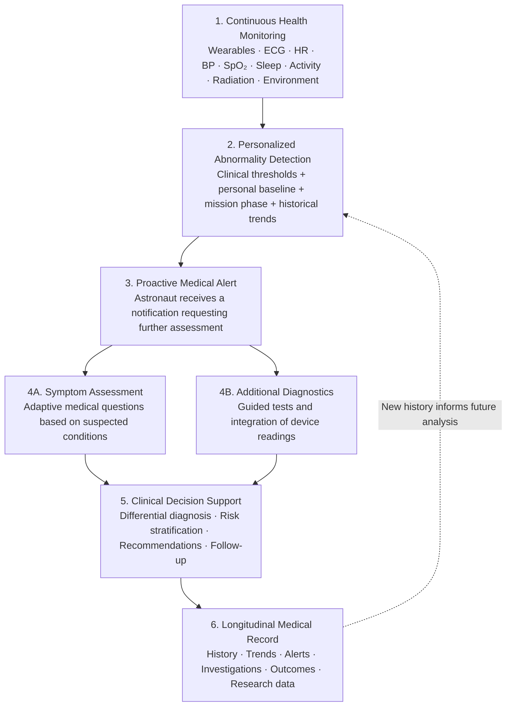

# 06 — AstroHealth: autonomous medical system concept

> **Status:** proposal from the team, **not yet confirmed**. It is an alternative / extension to direction A in [04-directions.md](04-directions.md). All numbers in the clinical example are invented for product design and are not validated thresholds. Claims marked *(verify)* need a source before use in UI or pitch.

What you're describing is essentially an **autonomous Clinical Decision Support System (CDSS)** that continuously monitors astronaut health, detects abnormalities, initiates personalized medical assessments, and maintains a dynamic medical record for each astronaut.

I would define the system as follows:

> **An autonomous, AI-powered clinical decision support system that integrates real-time physiological monitoring, detects clinically significant deviations, initiates personalized medical assessments, guides additional diagnostic testing, and maintains longitudinal astronaut health records for continuous care and research.**

The most important part of your idea is that the system does not wait for an astronaut to feel unwell and ask for help. **It proactively initiates medical interactions based on the data it receives.**

This also addresses a real need: NASA is already investigating autonomous CDSS solutions for missions far from Earth. In 2024, NASA described *(verify — source needed)* a model in which medical information is gathered through active and passive monitoring and used to provide real-time guidance. The direction therefore has a research foundation, but your system will need to demonstrate a clear advantage over existing initiatives.

**Relevant references:** [NASA Human Research Program](https://www.nasa.gov/hrp/) · [NASA Human Research Program hazards](https://www.nasa.gov/hrp/hazards/)

## 1. How Your System Would Work

There would also be a **feedback loop**: every new test result or answer updates the clinical assessment, and the outcome is stored for future comparison.

## 2. Clinical Example — How an Astronaut Would Experience the System

Imagine an astronaut on day 120 of a mission to Mars. The system detects a sustained increase in their resting heart rate compared with their individual baseline.

The following is an illustration of the system's logic, with **invented numbers for product design purposes**, not validated medical alert thresholds.

### Step 1 — Physiological Abnormality Detected

**System notification:**

> Resting heart rate has increased from your personal baseline of 62 bpm to a sustained average of 88 bpm.

First, the system checks signal quality, whether the astronaut was genuinely resting, activity context, and measurement reliability.

### Step 2 — Adaptive Symptom Assessment

The system asks questions designed to differentiate potential causes of the elevated heart rate:

- Are you experiencing chest pain or discomfort?
- Are you short of breath?
- Have you felt dizzy or faint?
- Do you have a fever or palpitations?
- How much fluid have you consumed?
- Have you recently exercised or undertaken unusual physical exertion?

### Step 3 — Recommended Diagnostic Tests

Depending on the answers and the approved medical protocol, the system may request:

- A repeat resting heart-rate measurement.
- Blood pressure, SpO₂, and temperature measurements.
- An ECG, if clinically indicated.
- Further laboratory testing **only if available and clinically justified**.

### Step 4 — Integrated Clinical Assessment

The system evaluates all available findings and presents a differential diagnosis, level of urgency, and degree of uncertainty.

**Possible considerations:** cardiovascular deconditioning, reduced circulating fluid volume, infection, arrhythmia, or another cause.

The system **must not rank or assert a diagnosis based on the illustrative heart-rate reading alone**.

### Step 5 — Documentation and Follow-up

The event, the astronaut's responses, additional test results, assessment, and follow-up plan are saved in the individual medical record. Subsequent measurements can trigger reassessment, closure of the event, or escalation.

The key is that the system should not stop at *“Your heart rate is abnormal.”* It must consider **what could explain the change, what information is missing to distinguish among the possibilities, and what action is appropriate next**.

If emergency warning signs are present, the normal questionnaire should be interrupted and an approved emergency pathway activated without waiting for the conversation to finish or for an unconstrained language model to make a decision.

> **Note:** This is a conceptual clinical workflow, not a validated diagnostic or triage tool.

## 3. The Most Important Scientific Challenge: What Counts as Abnormal in Space?

This may be one of the main factors determining whether the platform becomes a genuine medical system rather than a dashboard that displays physiological data.

**You cannot simply take normal reference ranges from Earth and apply them unchanged to astronauts in space.**

Microgravity produces physiological changes in fluid distribution, cardiovascular function, muscle systems, and sensorimotor function. Not every change indicates disease.

I would therefore use three levels of abnormality detection.

### A. Critical Clinical Thresholds

Values or combinations of findings requiring immediate investigation regardless of the personal baseline, such as dangerous measurements combined with severe symptoms.

**Source:** validated medical protocols, NASA standards, and clinician-reviewed rules.

### B. Personalized Baseline Deviation

Compare an astronaut with their own measurements from before flight, the beginning of the mission, and subsequent mission phases, while accounting for expected adaptation.

For instance, a measurement may still fall within a population reference range but deviate meaningfully from that astronaut's historical values.

### C. Spaceflight-Adjusted Reference Patterns

Compare measurements with patterns observed in other astronauts or analog studies, accounting for mission duration, gravity conditions, activity, and adaptation phase.

**This is where NASA's datasets are particularly useful.**

I would implement **Dynamic Reference Ranges**, while clearly separating fixed safety limits from statistical ranges that adapt over time.

Equally important, the system must not gradually normalize a persistent pathological change simply because it has lasted a long time. It should retain historical baselines, monitor trends, and impose safeguards on updates to an individual's reference ranges.

## 4. How to Use the Datasets You Have Already Identified

I would not use all datasets for the same purpose. Instead, I would divide them into four functions.

| Function in the system | Relevant information sources | What they provide |
|---|---|---|
| **Baseline and normal adaptation** | NASA NLSP, Spaceflight Standard Measures, CIPHER | Understanding expected physiological changes throughout a mission |
| **Abnormality detection** | NLSP longitudinal data, cardiovascular/exercise datasets, clinical guidelines | Supporting the development of models for detecting trends and deviations |
| **Clinical assessment** | Clinical protocols, NASA Exploration Medical Capability (ExMC), NASA-STD-3001 | Determining which questions to ask, which tests to perform, and when to escalate |
| **Research and clinical context** | NASA OSDR, Inspiration4, CIPHER | Potential relationships between physiological measurements, laboratory results, and molecular markers |

Two NASA resources are especially important when designing the system:

- **[NASA Spaceflight Standard Measures](https://www.nasa.gov/reference/standard-measures/):** Defines broad domains of measurement, including sleep, activity, cognition, immune function, blood and urine chemistry, and sensorimotor assessments.
- **[NASA CIPHER](https://www.nasa.gov/reference/cipher/):** An integrative research program comprising 14 studies of body systems, imaging, physical activity, cognition, and biomarkers measured before, during, and after spaceflight.

However, research datasets do not automatically provide validated normal ranges, alert sensitivity or specificity, labeled diagnoses, or medically approved treatment recommendations. A separate **clinical knowledge layer** is needed.

## 5. The Architecture I Would Build

### Sensor Integration Layer

Ingest information from different sensors and devices, including signal quality, measurement units, timestamps, device status, and missing data.

### Physiological Monitoring Engine

Calculate metrics, compare them with reference ranges, detect trends over time, identify deviations, and verify that apparent abnormalities are not measurement artifacts.

### Clinical Reasoning Engine

Manage differential diagnoses, follow-up questions, selection of additional tests, urgency classification, and conclusions according to validated protocols.

### Conversational Medical Interface

A chatbot that explains an abnormal finding, asks context-dependent questions, and guides the astronaut through the necessary tests.

### Longitudinal Electronic Health Record

Store medical history, real-time data, answers, tests, potential diagnoses, recommendations, follow-up plans, and outcomes.

### Research and Analytics Layer

Maintain a separate, coded and access-controlled research dataset for longitudinal studies, algorithm validation, and learning across missions.

### The Role of AI Versus the Clinical Rules Engine

I would make this distinction explicit:

**The clinical rules engine** is responsible for safety limits, emergency conditions, minimum assessment requirements, and situations that require human intervention.

**The AI** is responsible for interpreting context, conducting conversations, choosing questions from approved clinical pathways, summarizing information, and presenting a reasoned differential diagnosis.

The AI should **not invent medical protocols, medications, doses, or tests that are unavailable aboard the spacecraft**. Clinical recommendations must be constrained by approved medical knowledge and the actual equipment carried on the mission.

Technologically, this suggests combining a **rule-based clinical engine** with a language model using **Retrieval-Augmented Generation (RAG)** over an approved medical knowledge base, alongside a statistical engine for time-series analysis.

For a mission to Mars, all critical components must operate **offline**, without relying on Earth-based servers.

## 6. What Would Each Astronaut's Medical Record Look Like?

I would create an individual medical profile for each astronaut, containing:

- **Pre-flight baseline:** Medical history, medications, physiological measurements, functional status, and diagnostic findings.
- **Continuous physiological data:** Sensor readings, trends, and derived indicators.
- **Medical events:** Every abnormality, symptom, question and answer, diagnostic test, and result.
- **Clinical assessments:** Differential diagnoses, urgency, confidence/uncertainty, and recommendations.
- **Follow-up:** Monitoring plans, resolution, recurrence, and progression throughout the mission.

Each event should also record the origin of the data, the version of the algorithm used, the guideline supporting the decision, and any human approval.

Alongside the medical record, a separate research database should support longitudinal analysis while protecting astronaut privacy. Encryption, access control, audit trails, and local backups should be core design requirements rather than future add-ons.

## 7. What Would I Build First?

I would present the full vision while developing a **minimum viable product (MVP)** focused on three scenarios that demonstrate the entire workflow:

| Scenario | Trigger | Follow-up questions and diagnostic tests |
|---|---|---|
| **Sustained elevation in resting heart rate** | Deviation from the individual's baseline | Chest pain, shortness of breath, fever, hydration, BP, ECG |
| **Decline in physical performance** | Repeated reduction in workload or exercise capacity | Fatigue, pain, sleep, HR, SpO₂, strength assessment |
| **Sleep and cognitive changes** | Sleep disruption combined with declining cognitive performance | Fatigue, headache, other symptoms, repeat cognitive testing, environmental CO₂ |

Initially, you could feed the platform historical NASA measurements and use simulated data streams to demonstrate real-time monitoring. Clearly label which elements use genuine astronaut data and which are simulated.

For scientific evaluation, I would separately measure abnormal-event detection, false-alert rates, response time, the appropriateness of follow-up testing, and safety of system recommendations. Clinical logic should be validated against clinician-reviewed scenarios, not merely against answers produced by an AI model.

## 8. Is This Genuinely New Compared with What NASA Is Developing?

There is an important consideration: NASA has already described CDSS technology integrating medical information, active and passive monitoring, and decision guidance. Its 2024 research describes incorporating information from sensors, databases, and intelligent models into autonomous medical support.

Therefore, your project's novelty should not simply be **“AI-powered medical software for astronauts.”**

Instead, I would emphasize the ability to demonstrate **a complete, automated medical closed loop**:

### Detect → Investigate → Assess → Act → Learn

> **From passive physiological monitoring to proactive, personalized medical assessment and longitudinal follow-up.**

In other words, the system is not merely an abnormality detector or a medical chatbot. It initiates investigations, identifies missing diagnostic information, receives test results, updates the clinical assessment, and documents subsequent follow-up.

This could be a strong value proposition, but you will need to show how your implementation differs from, or performs better than, the CDSS systems NASA is already developing.

**The next step I would take is to build a Clinical Decision Matrix**: a table specifying, for every physiological parameter measured aboard the spacecraft, the sensor that generates it, what constitutes an abnormality, which diagnoses should be considered, which questions to ask the astronaut, which additional tests are available, and the possible recommendations and urgency levels.

That matrix would become the foundation for software development, integration of NASA datasets, and medical validation of the system.

---

## Suggested Reference Links

- [NASA Human Research Program — Human Spaceflight Hazards](https://www.nasa.gov/hrp/hazards/)
- [NASA Spaceflight Standard Measures](https://www.nasa.gov/reference/standard-measures/)
- [NASA CIPHER](https://www.nasa.gov/reference/cipher/)
- [NASA Open Science Data Repository](https://osdr.nasa.gov/)
- [NASA Life Sciences Portal](https://nlsp.nasa.gov/explore)
- [Project Data Sources Inventory](../technical/05-data-sources.md)
