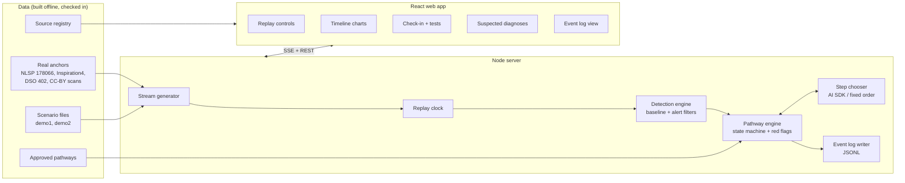

# 09 — Implementation plan

How we build the AstroHealth MVP: the two demo replays in [08-clinical-demos.md](../product/08-clinical-demos.md), milestone 1 (online LLM), then milestone 2 (offline model). Every design choice here traces to an ADR in [docs/adr/](../adr/). Terms follow [GLOSSARY.md](../../GLOSSARY.md).

## 1. Scope

**In the MVP (milestone 1):**
- Demo 2 (cardiovascular deconditioning) as a full replay, shown first.
- Demo 1 (internal jugular vein thrombosis) as a full replay (ADR 0008).
- The closed loop for both: detect → investigate → assess → act → learn.
- Replay controls, comm blackout switch, event log, REAL / SIMULATED / REFERENCE / COMPOSITE labels, a source link on every number.
- Online LLM (Claude through the AI SDK) that picks the next step from the approved pathway; fixed-order fallback.

**Milestone 2:** the same app with an open-weights model on the MacBook through Ollama, plus the evaluation that proves it (ADR 0004).

**Not in the MVP:** the research layer (architecture slide only), image interpretation, live sensors, multi-astronaut crew view, mission-profile switch, DONKI hazard panel (dropped by ADR 0001).

## 2. Architecture



**Key rule:** the pathway engine is deterministic and owns safety. It computes the set of **allowed next steps**. The step chooser only picks one of them (ADR 0002). With the link down, or with no LLM configured, the chooser takes the first allowed step in the pathway's fixed order.

## 3. Repo layout

A pnpm workspace in TypeScript.

```
apps/
  web/            React + Vite UI
  server/         Node (Fastify) API, replay, LLM gateway, event log
packages/
  core/           Pure domain logic, no I/O: types, baseline, alert filters, pathway engine, diagnosis ranking
  data/           Anchor loaders, stream generator, scenario loader
data/
  anchors/        Real values as JSON, one file per source, with source URL + license
  reference/      CC-BY scan images + ATTRIBUTION.md
scenarios/        demo1.yaml, demo2.yaml
pathways/         Approved pathways as YAML (questions, tests, actions, evidence weights, source links)
sources.json      Registry: every threshold or number shown in the UI → source link or "(verify)"
scripts/          fetch-anchors.ts: downloads NLSP / OSDR files and writes data/anchors
runs/             Event logs, one JSONL per replay run (git-ignored)
```

`packages/core` has no network or file access, so it runs the same in the server, in tests and in the milestone 2 evaluation.

## 4. Domain model

| Type | Fields (main) |
|---|---|
| `Sample` | `t` (mission time), `signal` (`hr`, `hrv`, `rr`, `skinTemp`, `spo2`, `activity`, `exerciseWorkload`, `exerciseHr`), `value`, `quality`, `label` (`REAL` / `SIMULATED`), `sourceId` |
| `Anchor` | `astronautId`, `measure`, `value`, `unit`, `condition` (pre-flight erect, in flight…), `sourceId`, `label` (`REAL` / `REFERENCE`) |
| `Astronaut` | `id`, `displayName`, `composite` (bool + sources, ADR 0009), `anchors[]`, `record` (imported history) |
| `Event` | `id`, `trigger` (`passive` / `surveillance` / `urgent`), `pathwayId`, `state`, `suspected[]`, `openedAt`, `closedAt`, `outcome` (`resolved` / `escalated`) |
| `PathwayStep` | `id`, `kind` (`question` / `activeTest` / `action` / `followUp` / `escalate`), `preconditions`, `evidence` (finding → weight per diagnosis), `sourceId` |
| `SuspectedDiagnosis` | `id`, `confidence`, `evidenceFor[]`, `evidenceAgainst[]`, `confirmingTest` |
| `LogLine` | timestamp, event ID, step type, data label, pathway ID, step ID, LLM provider + model, rule version, source link (Q18) |

## 5. Engines

### 5.1 Stream generator (`packages/data`)
- Reads a scenario file: astronaut, anchors, mission length, drift curves per signal, benign look-alikes (for example an exercise spike), scripted incident, scripted answers and test results.
- Starts each signal from the astronaut's real anchor, applies the expected in-flight adaptation, adds noise, then the scripted drift.
- Deterministic with a seed, so every replay run and test gives the same stream.

### 5.2 Replay clock (`apps/server`)
- Mission time advances at 1–30 mission days per minute (Q20).
- Slows down automatically when an event opens. Pauses at each question for the astronaut.
- Pushes samples and events to the web app over SSE.

### 5.3 Detection engine (`packages/core`)
In order (Q16, ADR 0007):
1. **Context filter:** drop samples during exercise, EVA or low signal quality, unless the signal is an exercise-device record at a matched workload.
2. **Resting windows:** sleeping heart rate from samples where activity confirms sleep.
3. **Space-adjusted band:** frozen pre-flight baseline + expected in-flight band per mission day (from published effect sizes, each with a source in `sources.json`).
4. **Persistence:** N windows in a row (scenario parameter, marked illustrative).
5. **Two signals:** one → silent watch; two agreeing → open event with a check-in question.
6. **Surveillance trigger:** rules from the record schedule an event (Demo 1).
7. **Urgent interrupt:** critical thresholds skip 1–5.
8. **Baseline update:** only from days with no open event, capped per update.

### 5.4 Pathway engine (`packages/core`)
- A state machine per event, loaded from `pathways/*.yaml`.
- After each answer or result, it recomputes: red flags (any → emergency pathway, stop), the ranked suspected diagnoses, and the allowed next steps.
- **Diagnosis ranking is deterministic:** evidence weights in the pathway update each diagnosis's score. The LLM does not set confidences. *(Proposed; confirm in review.)*
- **Minimum-evidence rule:** no suspected diagnosis shows until the pathway's rule passes (ADR 0005).
- **Close or escalate:** after the action, follow-up data must return to baseline within the pathway's window, or the event escalates.

### 5.5 Step chooser (`apps/server`)
- AI SDK `generateText` with one tool per allowed step. The model must call exactly one tool. The prompt gives the event so far and the pathway's purpose.
- Provider from config: `LLM_PROVIDER=anthropic | ollama | none`. The comm blackout switch forces `none`.
- `none`, a timeout, or an invalid tool call → the fixed-order fallback. The log records which one ran.
- The model also writes the astronaut-facing wording of a question. The UI shows the pathway's fixed wording when the chooser is `none`.

### 5.6 Event log (`apps/server`)
- Append-only JSONL, one file per run in `runs/` (Q18). The UI event log view reads the same file.

## 6. UI

| Screen area | Shows |
|---|---|
| Replay bar | Play, pause, speed, mission day, comm blackout switch, demo picker |
| Astronaut header | Name, REAL / COMPOSITE badge with sources |
| Timeline charts | Passive signals with the frozen baseline, expected band and REFERENCE band; event markers |
| Check-in panel | Questions with one-tap answers; active test requests and results |
| Suspected diagnoses | Ranked list with confidence, evidence for and against, confirming test; "Suspected – for crew medical officer confirmation" |
| Event log | Every step, with data label, pathway step, LLM provider, source link |
| Every number | Hover → source link from `sources.json`, or *(verify)* |

Demo 1 adds: an imported-record view (real Inspiration4 labs), the ultrasound checklist, the structured-finding form, and the CC-BY scans with their credit.

## 7. Milestones and tasks

Each task ends with tests passing and a PR (CLAUDE.md git workflow).

### M0 — Scaffold
1. pnpm workspace, TypeScript, Vitest, ESLint, Prettier, CI on PRs.
2. `sources.json` schema and a check that fails CI when a UI number has no entry.

### M1a — Data
3. `scripts/fetch-anchors.ts`: NLSP 178066 (Alex), DSO 402 (reference band), Inspiration4 OSD-575 / OSD-569 (Maya's labs; pick the subject with the lowest pre-flight albumin).
4. Download the Marshall-Goebel 2019 figures 3B and 3C into `data/reference/` with `ATTRIBUTION.md` (CC-BY).
5. Stream generator + `scenarios/demo2.yaml`.

### M1b — Core engines (Demo 2)
6. Detection engine with scenario tests: the benign exercise spike is ignored; the event opens on the scripted day.
7. Pathway engine + `pathways/deconditioning.yaml`; tests: red flag bypass, no step outside the pathway, minimum-evidence rule, close vs escalate.

### M1c — Server and UI (Demo 2 end to end with fixed order)
8. Replay clock, SSE stream, event log writer.
9. UI: replay bar, timeline charts with labels and bands, check-in panel, suspected diagnoses, event log view.

### M1d — Online step chooser
10. AI SDK gateway with Anthropic; tool per allowed step; fallback on timeout or invalid call; blackout switch.

### M1e — Demo 1
11. `scenarios/demo1.yaml`, surveillance trigger, `pathways/ijv-surveillance.yaml`.
12. UI: imported record, ultrasound checklist, structured finding, CC-BY scans, COMPOSITE badge.

### M1f — Pitch hardening
13. Resolve every *(verify)* item shown in the UI (list in section 9).
14. Full rehearsal of both demos in 3 minutes, with and without blackout.

### M2 — Offline model
15. Install Ollama on the MacBook; pull candidates (gpt-oss-20b, Qwen3 14B; check the library for newer ones).
16. Evaluation harness: run each scripted case N times per model; measure the four criteria in ADR 0004 (zero off-pathway steps, agreement with milestone 1, latency per step, works with the network off).
17. Choose the model, set `LLM_PROVIDER=ollama` as the blackout behavior, add an "offline model" badge in the UI.

**Order and parallel work:** M0 first. Then M1a (data) and the UI shell of M1c can run in parallel with M1b, because they meet at the types in `packages/core`. M1d needs M1b. M1e needs M1b and M1c. M2 can start its harness as soon as M1d works.

**Cut line if time runs short:** keep Demo 2 complete; reduce Demo 1 to the surveillance trigger, the ultrasound step and the escalation screen.

## 8. Testing

| Level | What |
|---|---|
| Unit (`packages/core`) | Baseline update cap, each alert filter, ranking updates, red flags |
| Scenario | Each scenario file → expected event log (golden file): trigger day, steps, suspected diagnoses, outcome |
| Safety | For every pathway: any red-flag answer → emergency pathway; no chooser output outside the allowed set reaches the log |
| Data | Every REAL value in `data/anchors` matches its source file; every UI number has a `sources.json` entry |
| LLM evaluation (M2) | The four ADR 0004 criteria, per model |

## 9. Open items

- **Deadline and team:** the hackathon date and who owns which milestone are not in the docs yet. Section 7 is ordered but not dated.
- **Diagnosis ranking:** confirm that evidence weights in the pathway, not the LLM, set the confidences (5.4).
- **To verify before the UI shows them:** Alex's flight (STS-40 or STS-58, Shykoff 1996); the Astroskin signal list; i-STAT and SLAMMD on the ISS; an HRP source for every threshold; the expected in-flight band per mission day for each signal.
- **Charts library:** Recharts is the default; change only if it cannot draw the bands.
