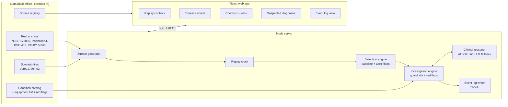

# 09 — Implementation plan

How we build the ORBIVIT MVP: the main demo replay and the secondary demo replay in [08-clinical-demos.md](../product/08-clinical-demos.md), milestone 1 (online LLM), then milestone 2 (offline model). Every design choice here traces to an ADR in [docs/adr/](../adr/). Terms follow [GLOSSARY.md](../../GLOSSARY.md).

## 1. Scope

**In the MVP (milestone 1):**
- Main demo (cardiovascular deconditioning, scenario `demo2-deconditioning`) as a full replay: the pitch demo (ADR 0012).
- Secondary demo (internal jugular vein thrombosis, scenario `demo1-ijv-thrombosis`) as a full replay, shown only if time allows (ADR 0008, ADR 0012).
- Platform extension in the pitch, not a demo: the arrhythmia catalog entry shows how the same loop handles urgent events.
- The closed loop for both: detect → investigate → assess → act → learn.
- Replay controls, comm blackout switch, event log, REAL / SIMULATED / REFERENCE / COMPOSITE labels, a source link on every number.
- A reviewed **condition catalog** of 10–15 spaceflight conditions and an **equipment list** (ADR 0010).
- Online LLM (Claude through the AI SDK) that reasons over the whole catalog inside code guardrails; uncatalogued fallback; no-LLM fallback.
- A **live branch** in the demo: the presenter changes an answer, and the ranking and next tests change.

**Milestone 2:** the same app with an open-weights model on the MacBook through Ollama, plus the evaluation that proves it (ADR 0004).

**Not in the MVP:** the research layer (architecture slide only), image interpretation, live sensors, multi-astronaut crew view, mission-profile switch, DONKI hazard panel (dropped by ADR 0001).

## 2. Architecture



**Key rule:** the LLM reasons, the code decides what is allowed. The investigation engine is deterministic and owns safety: red flags, the equipment list, the minimum-evidence rule and the evidence check. The clinical reasoner proposes a ranking and a next step; the engine rejects any proposal that fails a guardrail (ADR 0010).

## 3. Repo layout

A pnpm workspace in TypeScript.

```
apps/
  web/            React + Vite UI
  server/         Node (Fastify) API, replay, LLM gateway, event log
packages/
  core/           Pure domain logic, no I/O: types, baseline, alert filters, investigation engine, guardrails
  data/           Anchor loaders, stream generator, scenario loader
data/
  anchors/        Real values as JSON, one file per source, with source URL + license
  reference/      CC-BY scan images + ATTRIBUTION.md
scenarios/        demo1.yaml, demo2.yaml
catalog/
  conditions/     One YAML per condition: findings, confirming / ruling-out tests, questions, actions, source links
  equipment.yaml  Tests and devices on board
  red-flags.yaml  Findings that stop the investigation and escalate
sources.json      Registry: every threshold or number shown in the UI → source link or "(verify)"
scripts/          fetch-anchors.ts: downloads NLSP / OSDR files and writes data/anchors
runs/             Event logs, one JSONL per replay run (git-ignored)
```

`packages/core` has no network or file access, so it runs the same in the server, in tests and in the milestone 2 evaluation.

## 4. Domain model

| Type | Fields (main) |
|---|---|
| `Sample` | `t` (mission time), `signal` (`hr`, `hrv`, `rr`, `skinTemp`, `spo2`, `activity`, `exerciseWorkload`, `exerciseHr`), `value`, `quality`, `label` (`REAL` / `SIMULATED`), `sourceId` |
| `Anchor` | `astronautId`, `measure`, `value`, `unit`, `condition` (pre-flight erect, in flight…), `sourceId`, `label` (`REAL` / `REFERENCE`) |
| `Astronaut` | `id`, `displayName`, `composite` (bool + sources, ADR 0009), `anchors[]`, `record` (imported history) |
| `Event` | `id`, `trigger` (`passive` / `surveillance` / `urgent`), `pathwayId`, `state`, `suspected[]`, `openedAt`, `closedAt`, `outcome` (`resolved` / `escalated`) |
| `CatalogCondition` | `id`, `hazard`, `hrpRiskUrl`, `findings[]`, `questions[]`, `confirmTests[]`, `ruleOutTests[]`, `actions[]`, `followUp`, `sourceIds[]` |
| `Equipment` | `id`, `name`, `tests[]`, `consumable` (bool), `sourceId` |
| `Step` | `id`, `kind` (`question` / `activeTest` / `action` / `followUp` / `escalate`), `conditionId` or `uncatalogued`, `rationale` |
| `SuspectedDiagnosis` | `conditionId` or `uncatalogued: { name }`, `confidence`, `evidenceFor[]` and `evidenceAgainst[]` (each a log line ID), `confirmingTest` |
| `LogLine` | timestamp, event ID, step type, data label, pathway ID, step ID, LLM provider + model, rule version, source link (Q18) |

## 5. Engines

### 5.1 Stream generator (`packages/data`)
- Reads a scenario file: astronaut, anchors, mission length, drift curves per signal, benign look-alikes (for example an exercise spike), scripted incident, scripted answers and test results.
- Starts each signal from the astronaut's real anchor, applies the expected in-flight adaptation, adds noise, then the scripted drift.
- Deterministic with a seed, so every replay run and test gives the same stream.

### 5.2 Replay clock (`apps/server`)
- Mission time advances at 1–30 mission days per minute (Q20).
- Slows down automatically when an event opens. Pauses at each question for the astronaut.
- Pushes samples and events to the web app over SSE.

### 5.3 Detection engine (`packages/core`)
In order (Q16, ADR 0007):
1. **Context filter:** drop samples during exercise, EVA or low signal quality, unless the signal is an exercise-device record at a matched workload.
2. **Resting windows:** sleeping heart rate from samples where activity confirms sleep.
3. **Space-adjusted band:** frozen pre-flight baseline + expected in-flight band per mission day (from published effect sizes, each with a source in `sources.json`).
4. **Persistence:** N windows in a row (scenario parameter, marked illustrative).
5. **Two signals:** one → silent watch; two agreeing → open event with a check-in question.
6. **Surveillance trigger:** rules from the record schedule an event (Demo 1).
7. **Urgent interrupt:** critical thresholds skip 1–5.
8. **Baseline update:** only from days with no open event, capped per update.

### 5.4 Investigation engine (`packages/core`)
- One state per event: answers, test results, the current ranking, the steps done.
- Before each step, it checks **red flags** (`red-flags.yaml`). Any red flag → emergency escalation, and the investigation stops.
- It validates every proposal from the clinical reasoner:
  - each diagnosis is a catalog condition, or is marked uncatalogued under the 5.5 rules;
  - each cited piece of evidence is a real log line;
  - a requested test is on the equipment list and not used up;
  - an action comes from that condition's approved pathway (uncatalogued: escalation only);
  - no diagnosis shows before the minimum-evidence rule passes (ADR 0005).
- A rejected proposal is logged with the reason, and the reasoner gets one retry; then the no-LLM fallback runs.
- **Close or escalate:** after the action, follow-up data must return to baseline within the condition's follow-up window, or the event escalates. Uncatalogued events always escalate.

### 5.5 Clinical reasoner (`apps/server`)
- AI SDK `generateObject` with a schema: ranked diagnoses (catalog ID or uncatalogued name, confidence, cited log line IDs), the next step, the astronaut-facing wording.
- The prompt holds the event log so far, the full catalog, the equipment list and the rules.
- **Uncatalogued mode:** allowed only when the reasoner reports that no catalog condition explains the evidence, or all catalog confidences stay below a set level. The UI labels it **UNCATALOGUED – not from an approved pathway** (ADR 0010).
- Provider from config: `LLM_PROVIDER=anthropic | ollama | none`. The comm blackout switch forces `none` in milestone 1 and `ollama` in milestone 2.
- **`none`:** catalog findings that match give an unranked list of possible causes; tests run in each condition's fixed order; no match → escalate.

### 5.6 Event log (`apps/server`)
- Append-only JSONL, one file per run in `runs/` (Q18). The UI event log view reads the same file.

## 6. UI

Since M1h the screen has two sides. The astronaut uses the tablet under stress and with little time, so it shows one task at a time in plain words. The clinical detail is on a separate panel for the crew medical officer and the judges.

| Screen area | Shows |
|---|---|
| Presenter bar | Demo picker, play, pause, restart, speed, mission day, comm blackout, autopilot, live branch (answer override), reasoner. Not part of the product |
| Tablet (astronaut) | Status line, one alert, and one screen: all clear, check-in ready (why now + Start), question, measurement, guided scan, thinking, handed to the crew medical officer, follow-up, escalation, resolved |
| Tablet question | Phase stepper (Questions → Measure → Review), question N, one of three answer forms by question kind: Yes/No buttons, one big button per option, or a text box. "Why we ask" shows the reasoner rationale |
| Tablet guided scan | One checklist step per screen with Back and Next, then the structured finding as big buttons, then Save |
| Tablet escalation | Full red screen: "Contact your crew medical officer now", the plain reason, "suspected, not confirmed", I understand |
| Clinical alert strip | The same alert levels, worded for the crew medical officer; the silent watch shows only here |
| Crew medical officer card | Suspected diagnoses with confidence in words and % (cut-offs illustrative), evidence in plain words with links to log lines, confirming test, HRP risk; the one recommended action with Approve; today's scan |
| Timeline charts | Passive signals with the frozen baseline, expected band and REFERENCE band; event markers |
| Audit log | Every step, with data label, catalog condition or UNCATALOGUED, LLM provider, rejected proposals; collapsed by default |
| Every number | Hover → source link from `sources.json`, or *(verify)* |

Alert levels (one per side, written in words, never color only):

| Level | Tablet | Clinical panel |
|---|---|---|
| critical | Escalation screen (urgent interrupt, red flag, escalating action, failed follow-up) | Escalated, with the reason and the action text |
| warning | — | An action waits for approval |
| caution | Check-in ready or in progress | Event open |
| info | Handed to the crew medical officer; follow-up | Follow-up; silent watch |
| none | All clear; resolved | No open event; resolved |

The pure state functions (`apps/web/src/flow.ts`) pick the tablet screen and both alerts; they are unit-tested.

The secondary demo (Demo 1 in code) adds: an imported-record view (real Inspiration4 labs), the ultrasound checklist, the structured-finding form, and the CC-BY scans with their credit.

## 7. Milestones and tasks

Each task ends with tests passing and a PR (CLAUDE.md git workflow).

### M0 — Scaffold
1. pnpm workspace, TypeScript, Vitest, ESLint, Prettier, CI on PRs.
2. `sources.json` schema and a check that fails CI when a UI number has no entry.

### M1a — Data
3. `scripts/fetch-anchors.ts`: NLSP 178066 (Alex), DSO 402 (reference band), Inspiration4 OSD-575 / OSD-569 (Maya's labs; pick the subject with the lowest pre-flight albumin).
4. Download the Marshall-Goebel 2019 figures 3B and 3C into `data/reference/` with `ATTRIBUTION.md` (CC-BY).
5. Stream generator + `scenarios/demo2.yaml`.

### M1b — Catalog and core engines
6. Condition catalog: pick 10–15 conditions from the HRP risk list (must include deconditioning, VTE, reduced fluid volume, infection, arrhythmia); draft each entry with an LLM, then team review; `equipment.yaml`; `red-flags.yaml`.
7. Detection engine with scenario tests: the benign exercise spike is ignored; the event opens on the scripted day.
8. Investigation engine with guardrail tests: red flag bypass, unknown test rejected, invented evidence rejected, minimum-evidence rule, close vs escalate, uncatalogued always escalates.

### M1c — Server and UI (Demo 2 end to end with the no-LLM fallback)
9. Replay clock, SSE stream, event log writer.
10. UI: replay bar, timeline charts with labels and bands, check-in panel, suspected diagnoses, event log view.

### M1d — Online clinical reasoner
11. AI SDK gateway with Anthropic; structured output; guardrail validation with one retry; uncatalogued mode; blackout switch; answer override for the live branch.

### M1e — Demo 1
12. `scenarios/demo1.yaml`, surveillance trigger from the record (VTE catalog entry).
13. UI: imported record, ultrasound checklist, structured finding, CC-BY scans, COMPOSITE badge.

### M1f — Pitch hardening
14. Resolve every *(verify)* item shown in the UI (list in section 9).
15. Full rehearsal of the main demo in 3 minutes, with and without blackout, including one live branch.

### M1g — Standard medical data interface
Coded measurements, UCUM units, terminology registries and a FHIR R4 export: [10-medical-data-standards.md](10-medical-data-standards.md) §7, ADR 0011.

### M1h — Crew UX
- Split the screen into the astronaut tablet (wizard, one task per screen) and the clinical panel; move replay controls to a presenter bar.
- Alert levels on both sides; escalation screen on the tablet.
- Question kinds: yesNo, choice (options with findings) and text (keywords; a keyword right after "no", "not", "without" or "never" does not count).

### M2 — Offline model
Background on how NASA and tech companies run medical AI offline, and candidate models: [11-offline-medical-ai-landscape.md](11-offline-medical-ai-landscape.md).
16. Install Ollama on the MacBook; pull candidates (gpt-oss-20b, Qwen3 14B, MedGemma 27B; check the library for newer ones).
17. Evaluation harness: run each scripted case and its live branches N times per model; measure the five criteria in ADR 0004 (zero guardrail failures that reach the UI, agreement with milestone 1 on next step and top diagnosis, latency per step, works with the network off).
18. Choose the model, set `LLM_PROVIDER=ollama` as the blackout behavior, add an "offline model" badge in the UI.

**Order and parallel work:** M0 first. Then M1a (data) and the UI shell of M1c can run in parallel with M1b, because they meet at the types in `packages/core`. Catalog drafting (task 6) can start on day one. M1d needs M1b. M1e needs M1b and M1c. M2 can start its harness as soon as M1d works.

**Cut line if time runs short:** keep the main demo complete; reduce the secondary demo to the surveillance trigger, the ultrasound step and the escalation screen.

## 8. Testing

| Level | What |
|---|---|
| Unit (`packages/core`) | Baseline update cap, each alert filter, each guardrail, red flags |
| Scenario | Each scenario file → expected trigger day, top suspected diagnosis, outcome. LLM runs are not exact, so tests check these and the guardrails, not exact confidences |
| Live branch | Changed answers (for example fever: yes) move the top diagnosis to the expected condition |
| Uncatalogued | Evidence that fits no catalog condition → UNCATALOGUED label, no treatment action, escalation |
| Safety | Any red-flag answer → emergency escalation; no proposal that fails a guardrail reaches the UI |
| Data | Every REAL value in `data/anchors` matches its source file; every UI number has a `sources.json` entry |
| LLM evaluation (M2) | The five ADR 0004 criteria, per model |

## 9. Open items

- **Deadline and team:** the hackathon date and who owns which milestone are not in the docs yet. Section 7 is ordered but not dated.
- **Catalog:** which 10–15 conditions, and who reviews each entry.
- **Uncatalogued threshold:** the confidence level below which uncatalogued mode is allowed (tune on the scenarios).
- **Verified in M1f:**
  - Alex's flight: the open data does not say whether subject 1 flew STS-40 or STS-58 (three subjects each). The UI says so instead of naming one.
  - SLAMMD on the ISS (NASA ISS Daily Summary 07/16/14) and the i-STAT in the ISS vascular contingency kit (NASA/SP-20250001074).
  - The VTE risk score page (OCHMO) exists.
  - The Demo 1 surveillance interval: NASA screens IJV flow at L+30 and L+60 days (NASA/SP-20250001074).
- **Still open:**
  - Clinical review of the condition catalog and the ultrasound checklist (`catalog-draft`).
  - Alert bands, persistence and the baseline window are design parameters, labeled `illustrative` in the UI. No HRP source gives a per-day in-flight band for wearable signals.
  - The Astroskin signal list is not shown in the UI, so it is not verified.
- **Charts library:** Recharts is the default; change only if it cannot draw the bands.
